# LevelUp Store — Screenshots

> Visual showcase of the **LevelUp Store** e-commerce platform.
> Full project: [developer-samuel/levelup-store](https://github.com/developer-samuel/levelup-store)

---

## E-commerce

  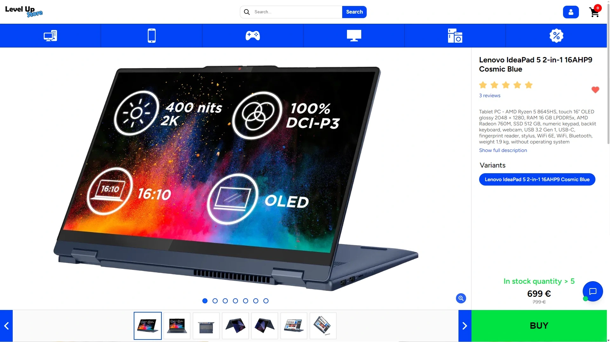
  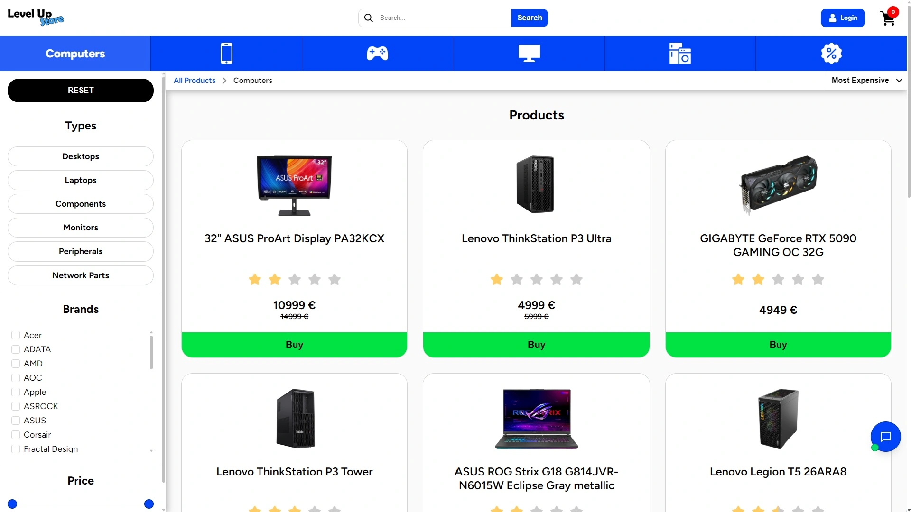

  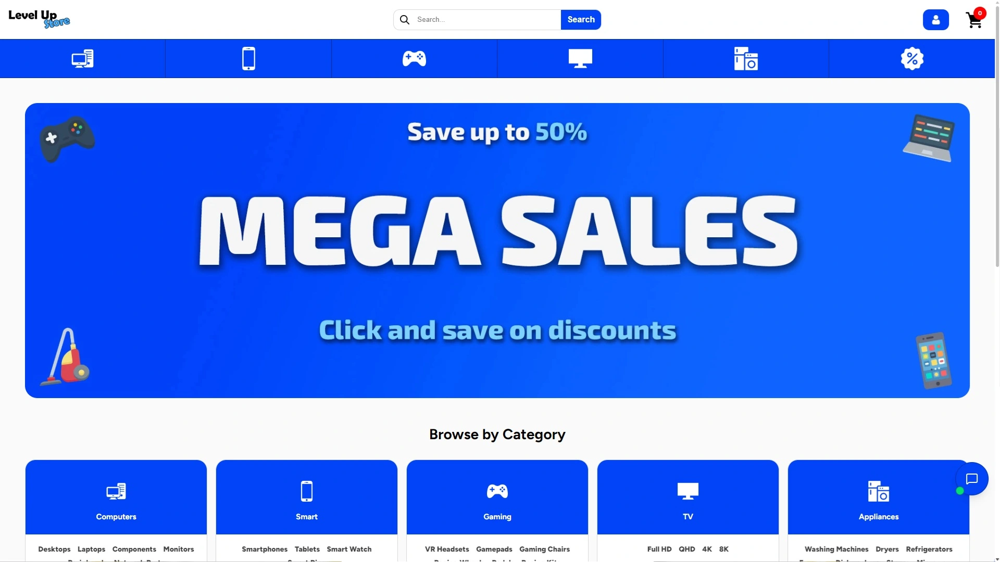
  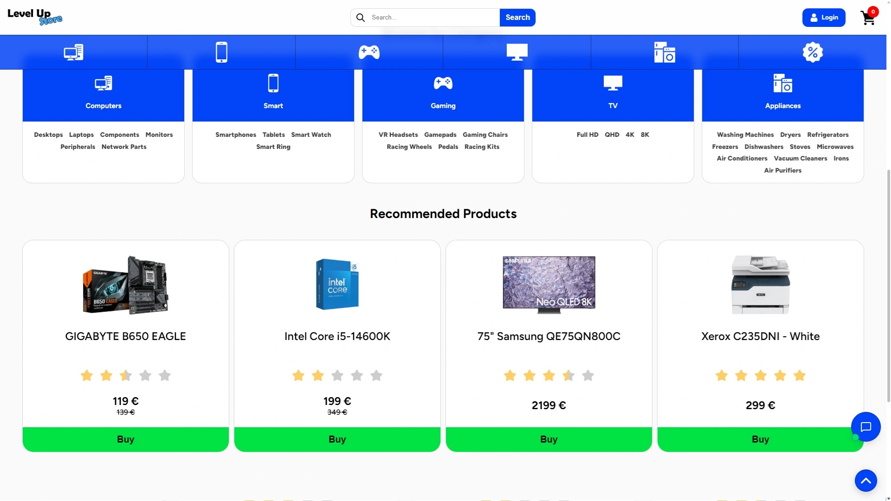

  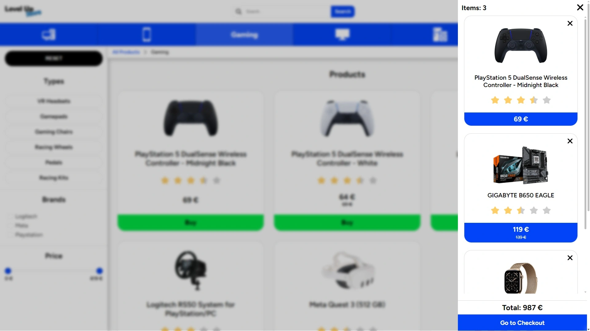
  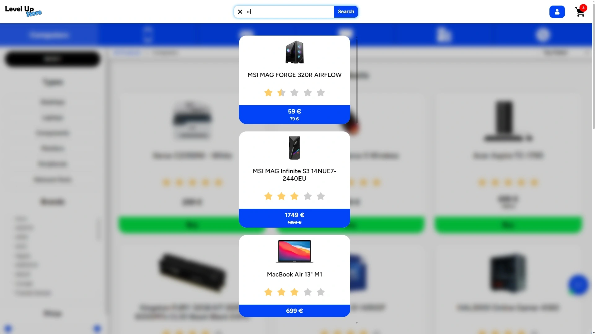

  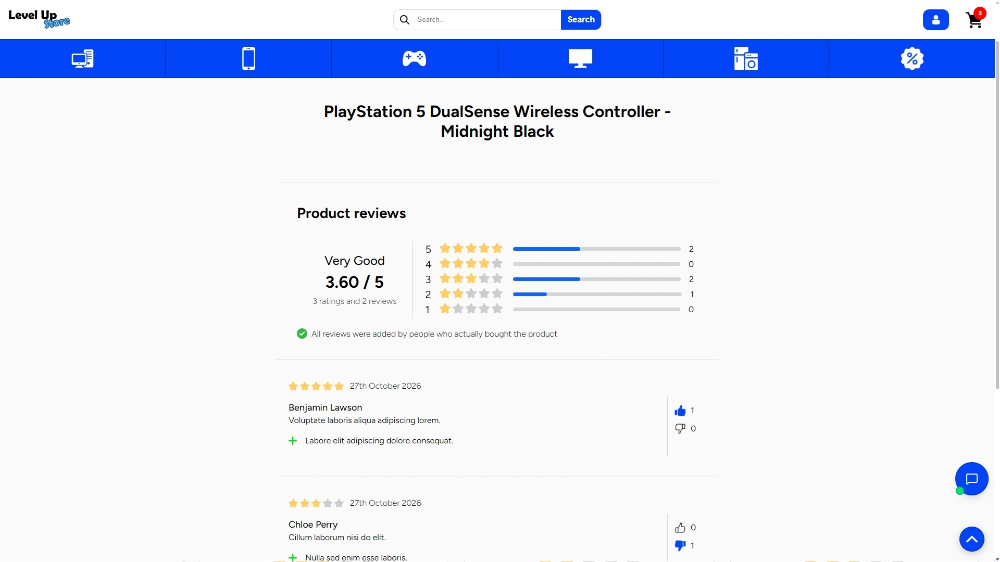

---

## AI Assistant

  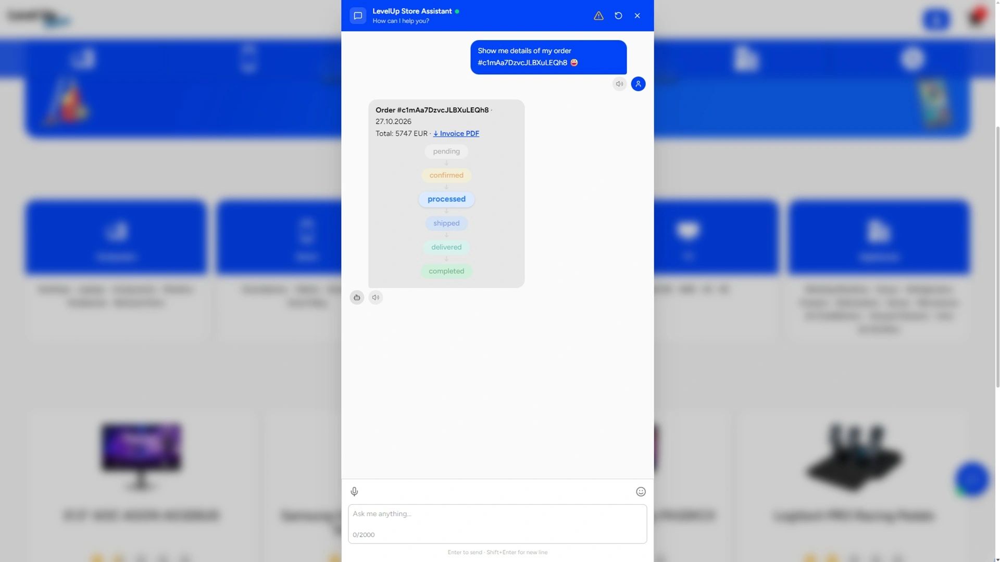
  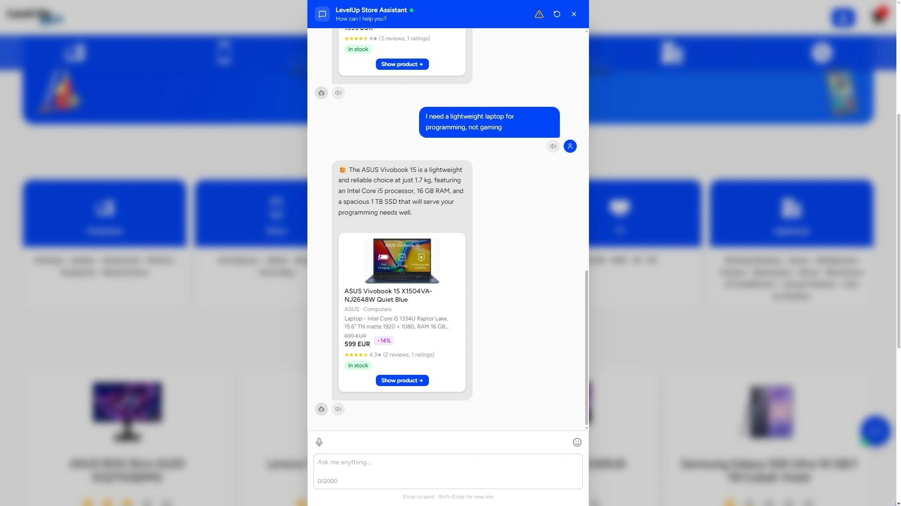

  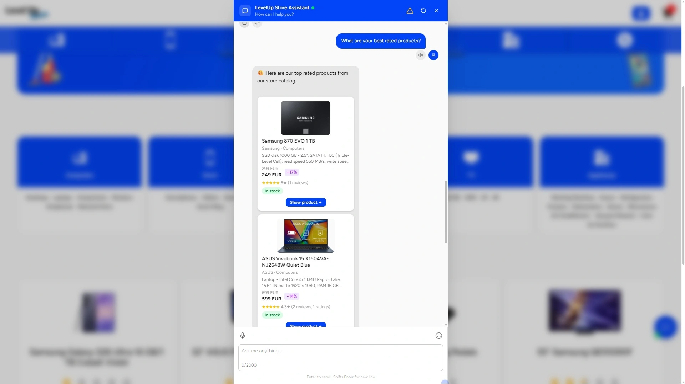
  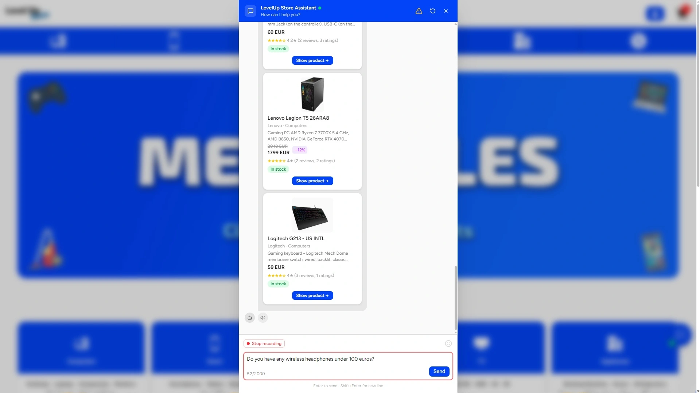

  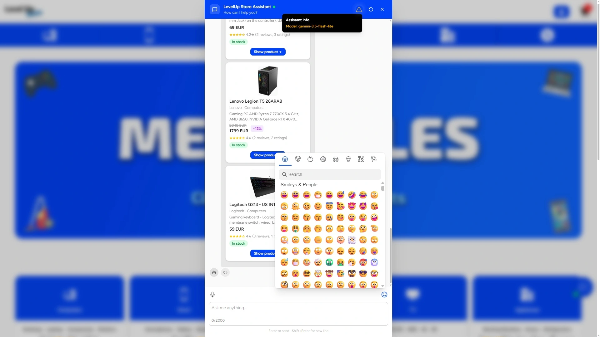
  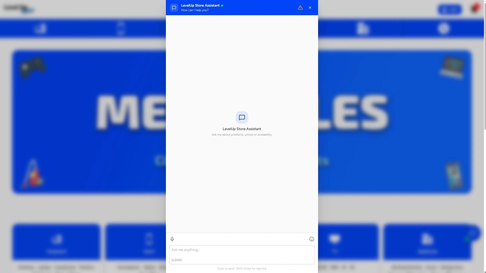

